You can use the ArPI board for replacing the main board of an existing security system or building a new.

For that you need the following components:

* power supply (SCP-35/50-12 UPS)
* GSM module (SIM900)
* RTC module (DS3231)
* Wiegand keypad (Wiegand 26/34)

You can reuse the following components from the existing system:

* sensors
* syren

!!! warning
    Be careful when connecting the components of the system.
    Wrong connections can damage the ArPI board or the connected components.
    

## Connect the raspberry pi

Connect the Raspberry Pi to the ArPI board with the 40 pin GPIO connector.
The ArPI board is designed physically to fit under the Raspberry Pi 2 Zero,
but you can use with other Raspberry Pi models as well.

When connecting to other models make sure the GPIO pins are aligned correctly.
You can use a 40 pin GPIO extension cable for that with the correct orientation.
See: [Raspberry Pi GPIO pinout](https://pinout.xyz/)

<figure markdown="span">
    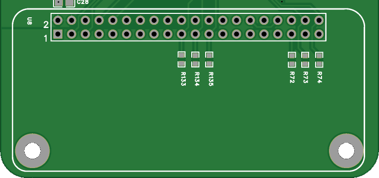
    <figcaption>ArPI board header</figcaption>
</figure>

## Connect power supply

You need a 12V 5A power supply preferred with UPS battery backup (SCP-35/50-12 UPS).
In case of an UPS power supply you can use the "S+" input for identifying the power outage by
pulling it to ground.

=== "V3 board"
    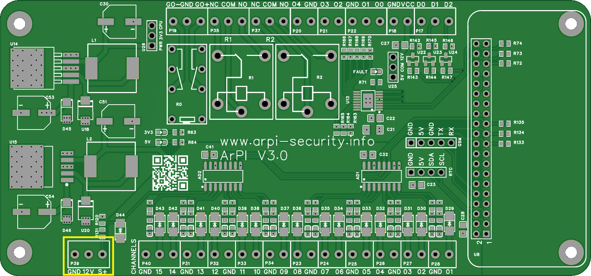

=== "V2 board"
    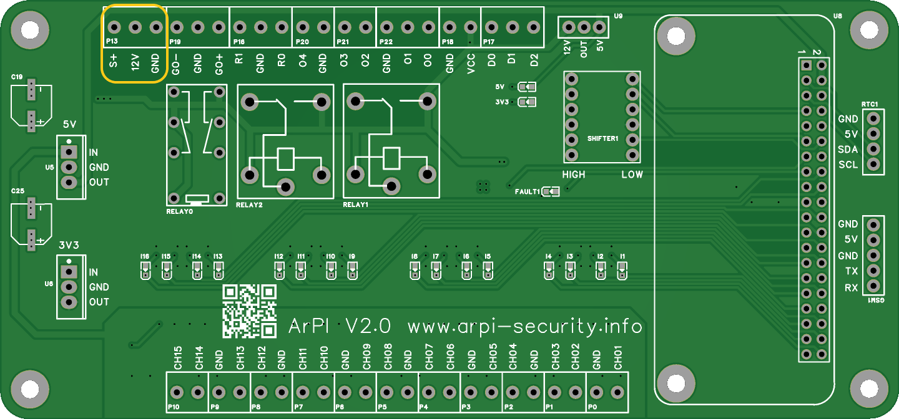

## Connect sensors

Sensors can be connected with NC/NO connections.

=== "V3 board"
    The V3 board supports 1 or 2 EOL resistors for each sensor and also zon doubling.
    For more information see [Wiring sensors with V3 board](installation-sensors.md).

    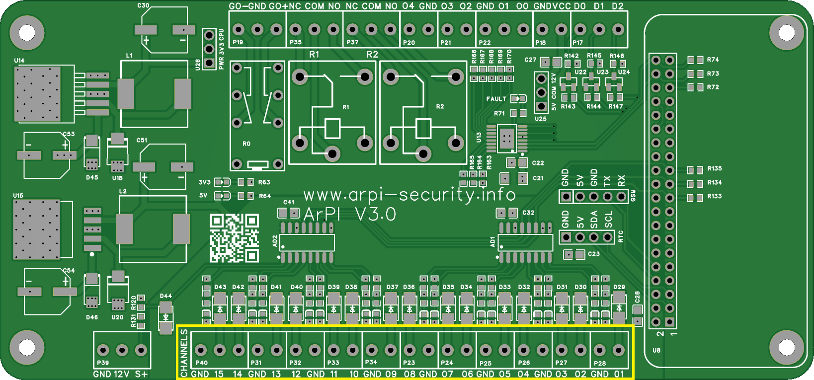

=== "V2 board"
    With the V2 board you have to use a single EOL resistor for each sensor.

    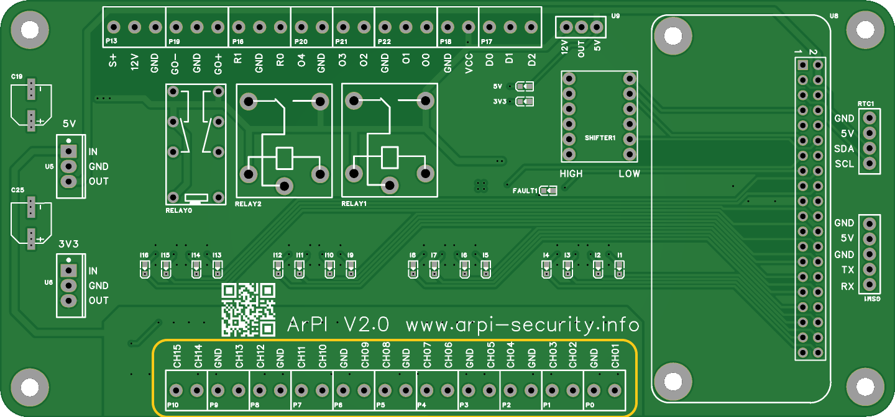

## Connect syren/outputs

The syren can be connected to the GO+ or GO- terminals.

* The GO+ terminal will be pulled from GND to 12V when the syren should be activated.
* The GO- terminal will be pulled from 12V to GND when the syren should be activated.

=== "V3 board"
    Configurable outputs:
        * R0/R1 - relay outputs with NC/NO contacts
        * O0,O1,O2,O3,O4 - open collector outputs pulled up to 12V with 10k resistor

    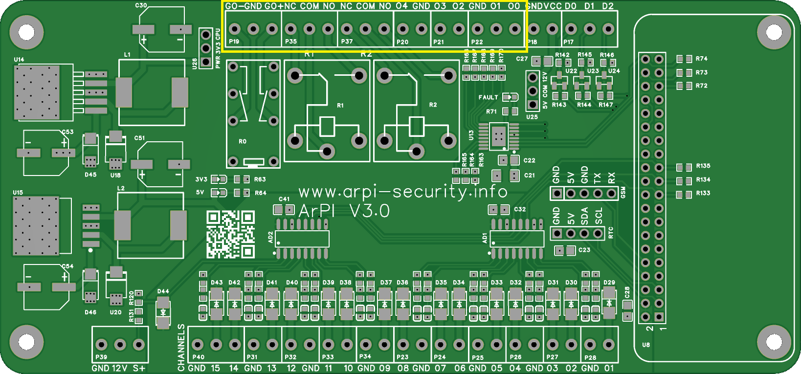

=== "V2 board"
    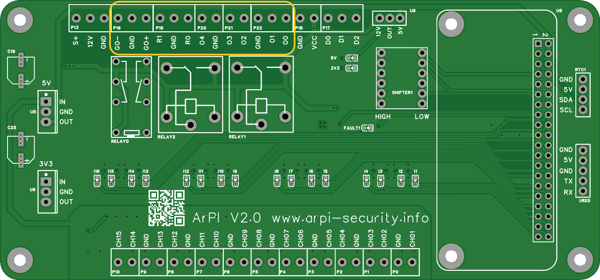

## Connect Wiegand keypad

The keypads needs power supply and data connections.

* D0 - Wiegand Data 0
* D1 - Wiegand Data 1
* D2 - Wiegand doorbell

=== "V3 board"
    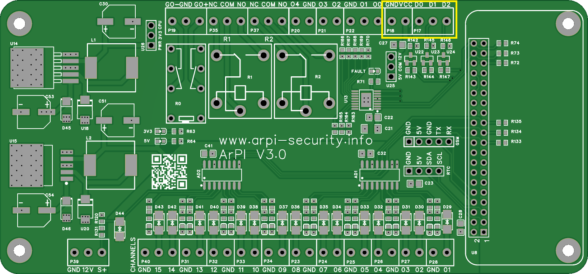

=== "V2 board"
    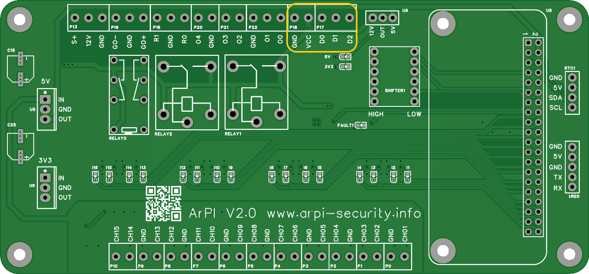

## Connect GSM module

The GSM needs power supply and data connections.

* GND - GSM GND
* VCC - GSM VCC
* TX - GSM RX
* RX - GSM TX

=== "V3 board"
    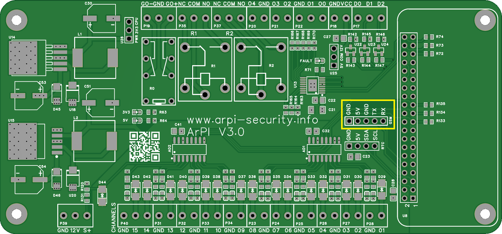

=== "V2 board"
    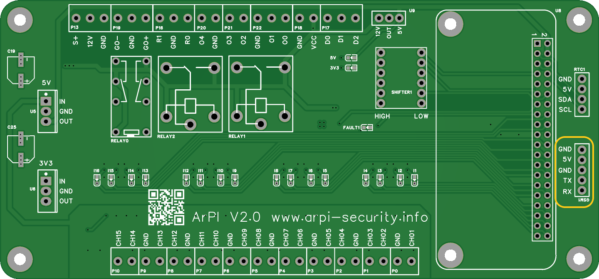

## Connect RTC

The RTC needs power supply and data connections.

* VCC - RTC VCC
* GND - RTC GND
* SDA - RTC SDA
* SCL - RTC SCL

=== "V3 board"
    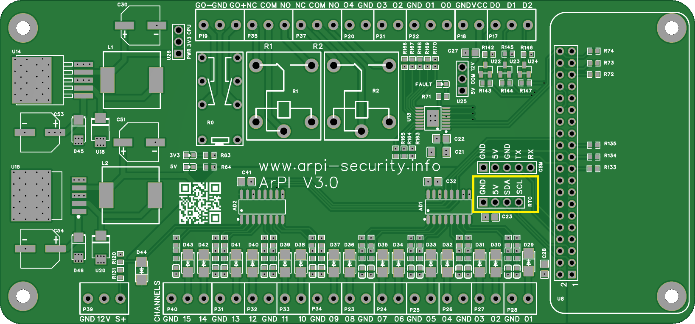

=== "V2 board"
    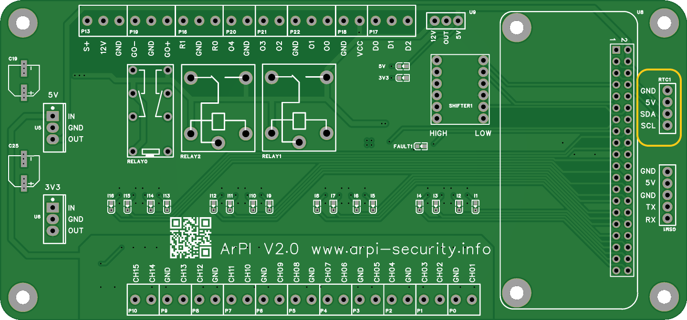
