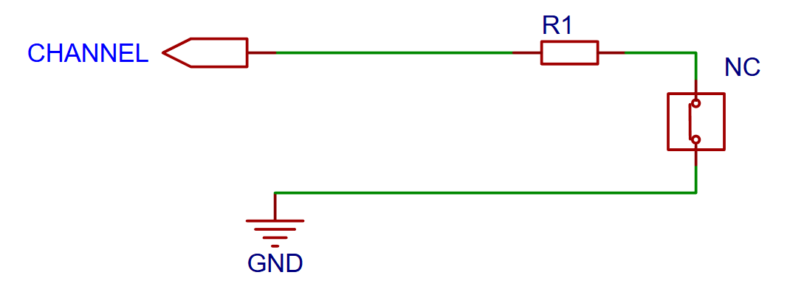
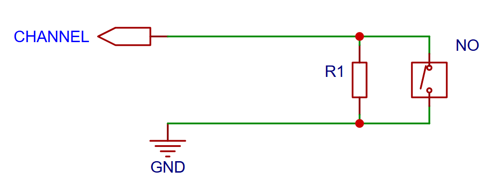
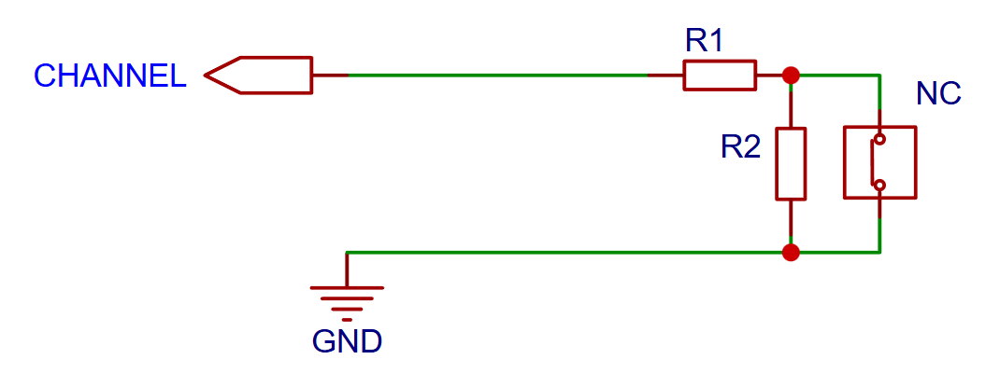
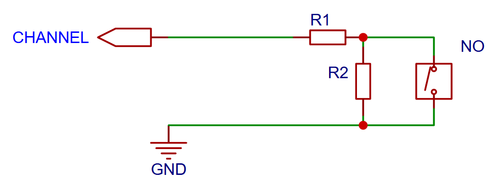
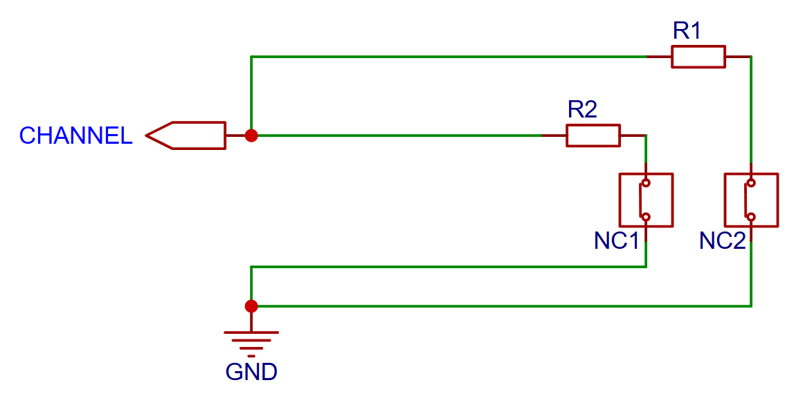
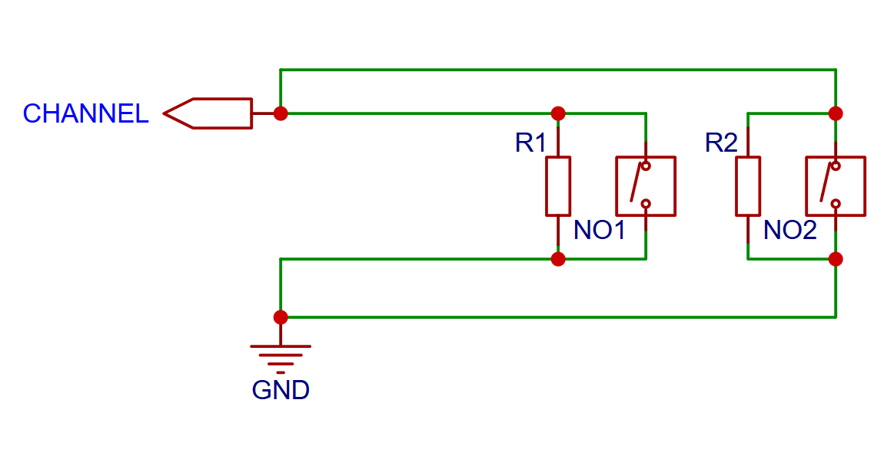

The sensors can be connected to the input channels of the ArPI board. The board provides 15 numbered channels (CH01 to CH15) for sensor connections.

## V2 Board Sensor Wiring

The V2 board supports two connection methods:

* **Single EOL resistor**: One resistor per sensor to avoid floating inputs
* **Direct connection**: Simple wiring without resistors (not recommended)

## V3 Board Sensor Wiring

The V3 board offers three wiring methods with different capabilities:

### Choosing the Right Wiring Method

| Method             | Resistors per Sensor | Detects Wire Cut | Detects Short Circuit | When to Use |
|--------------------|----------------------|------------------|-----------------------|-------------|
| **Single EOL**     | 1                    | ✓ NO             | ✓ NC                 | Simple installations |
| **Double EOL**     | 2                    | ✓                | ✓                    | Maximum security |
| **Zone Doubling**  | 1 per sensor         | ✓ NO             | ✓ NC                 | For using more than 15 sensors |

!!! info "Error Detection Capabilities"
    * **Single EOL**: Can detect either wire cut OR short circuit (depending on NC/NO type), but not both
    * **Double EOL**: Can detect both wire cut AND short circuit simultaneously, providing maximum security against tampering

!!! tip "Practical Recommendations"
    * Use **Single EOL** for basic installations where simplicity is preferred
    * Use **Double EOL** for critical detection points like main entry doors and windows
    * Use **Zone Doubling** only when you need more than 15 sensors
    * Always use resistors - never leave inputs floating as this causes unreliable detection

### Single EOL Resistor

Uses one resistor (R1 = 5.6 kΩ) per sensor. The system detects sensor activation by measuring voltage changes, but can only distinguish one type of fault (either cut or short) depending on the sensor type.

<figure markdown="span">
    
    <figcaption>NC sensor with single EOL resistor - detects wire cut and sensor opening</figcaption>
</figure>
<figure markdown="span">
    
    <figcaption>NO sensor with single EOL resistor - detects wire short and sensor closing</figcaption>
</figure>

---

### Double EOL Resistor

Uses two resistors (R1 = 5.6 kΩ and R2 = 1 kΩ) per sensor. This configuration creates multiple voltage levels, allowing the system to distinguish between normal operation, sensor activation, wire cut, and short circuit - providing comprehensive tamper protection.

<figure markdown="span">
    
    <figcaption>NC sensor with double EOL resistor - full tamper detection</figcaption>
</figure>
<figure markdown="span">
    
    <figcaption>NO sensor with double EOL resistor - full tamper detection</figcaption>
</figure>

---

### Zone Doubling

Connects two sensors to a single channel using resistors (R1 = 5.6 kΩ for sensor A and R2 = 1 kΩ for sensor B).
This allows up to 30 sensors on the 15 available channels when standard capacity is insufficient.

<figure markdown="span">
    
    <figcaption>Two NC sensors on one channel using zone doubling</figcaption>
</figure>
<figure markdown="span">
    
    <figcaption>Two NO sensors on one channel using zone doubling</figcaption>
</figure>
